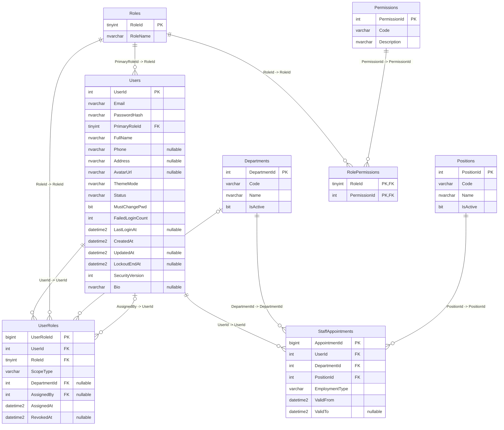
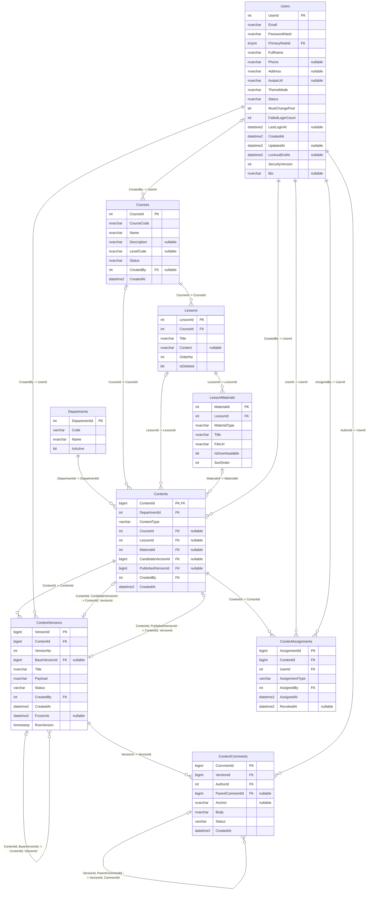
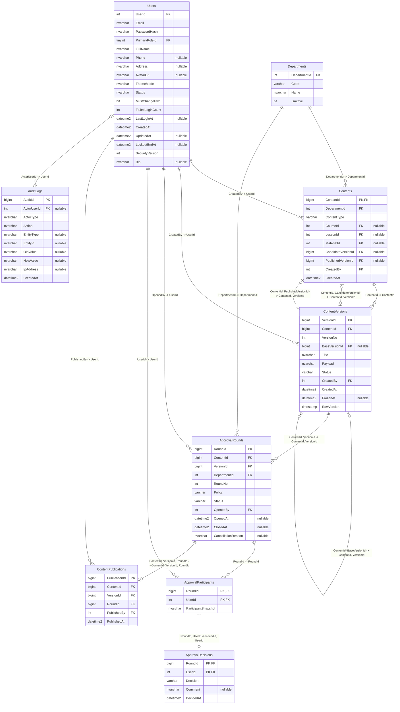

# ERD phân quyền và quản trị nội dung LMS TEKY

Sinh trực tiếp từ metadata SQL Server sau migration; chỉ bao gồm phần chuyên môn và các bảng LMS liên quan.

`PK`: khóa chính; `FK`: khóa ngoại; các cột PK trong cùng bảng tạo khóa chính ghép. `nullable`: có thể để trống.
Đường nối ghi cột FK và cột được tham chiếu; thứ tự tương ứng với khóa ghép. Bảng xuất hiện lại ở nhiều sơ đồ để dễ đọc.

`Users.PrimaryRoleId` chỉ chọn giao diện mặc định. Phân quyền thực tế dùng `UserRoles`, `RolePermissions`, phạm vi và phân công.

## Nhân sự và phân quyền

## Nội dung và phiên bản

## Xét duyệt và công bố

Quan hệ qua unique filtered index chỉ duy nhất trong điều kiện index (ví dụ grant chưa thu hồi).

Xem [hướng dẫn migration và ràng buộc nghiệp vụ](academic-governance.md).
